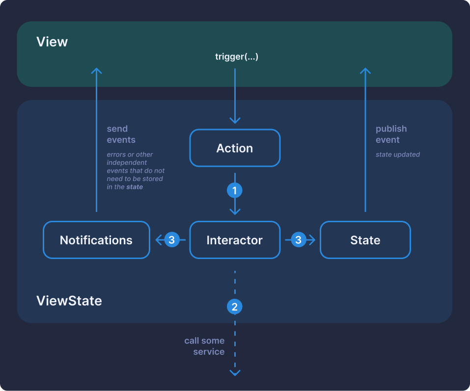

# View · ViewState · Interactor (VVSI)

VVSI is a thin unidirectional layer for SwiftUI: something between [TCA](https://github.com/pointfreeco/swift-composable-architecture) and free-form MVVM, without TCA ceremony.

**View** renders state and sends actions. **ViewState** owns state. **Interactor** reduces synchronous actions immediately and returns optional async **Work**. One-shot UI (alerts, toasts) uses **events**, not state flags.

Current version: **0.2.0-alpha.1** (breaking vs 0.0.x — see [Migration](#migration-00x--020) and [Changelog](CHANGELOG.md)).

## Architecture



```text
View  --trigger(action)-->  ViewState  --reduce(&state, action)-->  Interactor
  ^                           |                                      |
  |                     published state                        Work<S>?
  +----- onReceive(events) / eventStream <---- EventPipe <-----+
```

Synchronous actions complete before `trigger` returns and allocate no task. Returned `Work` runs as a tracked unstructured task with a selectable policy. Call `viewState.cancel()` to cooperatively cancel all in-flight work.

## Why VVSI

- Clear split: UI / state / side effects
- Zero-task fast path for synchronous actions
- Predictable async updates via `updater`
- Easy to unit-test Interactor + ViewState
- Async `Work` with policies and cooperative cancellation
- Native SwiftUI (`ObservableObject`, `@StateObject`); experimental `@Observable` spike available

### Compared with MVVM

VVSI keeps the low ceremony and native SwiftUI integration of a small ViewModel, but makes the feature contract explicit:

- user intent is represented by typed actions instead of arbitrary ViewModel methods;
- synchronous state transitions happen in one `reduce` entry point;
- async work has shared cancellation and concurrency policies;
- one-shot events do not need to be stored as resettable state flags;
- Interactor and ViewState can be tested without rendering a View.

The trade-off is additional structure. A simple screen with a few independent properties may be clearer as plain MVVM.

### Compared with TCA

VVSI adopts unidirectional actions and reducer-like state changes, but intentionally omits most framework machinery:

- no external dependencies beyond Apple frameworks;
- no Store scoping, dependency system, navigation model, macros, or exhaustive TestStore;
- synchronous actions do not allocate a task;
- async `Work` updates state directly through a MainActor-isolated updater;
- the API is small enough to understand from the core source files.

This makes VVSI easier to introduce feature by feature, but less strict than TCA. In TCA, async work normally sends another action through the reducer; in VVSI, `Work` may update state directly. TCA is a better fit when exhaustive state-transition testing, deep composition, and standardized dependency management are more important than a minimal API.

### When VVSI fits

Choose VVSI when plain MVVM has become difficult to keep consistent, but adopting a full application architecture would be disproportionate. It is aimed at small and medium SwiftUI features that need predictable state, testable async work, and cancellation without a large framework surface.

VVSI is not intended to replace TCA for every application. Large state trees, complex navigation, cross-feature composition, and organization-wide architecture enforcement are currently outside its scope.

## Installation

### Swift Package Manager

```swift
dependencies: [
    .package(url: "https://github.com/hudishkin/vvsi.git", exact: "0.2.0-alpha.1")
]
```

### Cursor Skill

```bash
mkdir -p skills
cp -R path/to/vvsi/skills/vvsi skills/vvsi
```

See [`skills/vvsi`](skills/vvsi).

## How to use

### 1. State, actions, events

```swift
extension ListView {

    struct VState: StateProtocol {
        var items: [String] = []
        var isLoading = false
    }

    enum VAction: ActionProtocol {
        case add
        case remove
        case load
    }

    enum VEvent: EventProtocol {
        case error(String)
    }
}
```

### 2. Interactor

```swift
extension ListView {

    final class Interactor: ViewStateInteractorProtocol, InitialStateProtocol {

        typealias S = VState
        typealias A = VAction
        typealias N = VEvent

        let events = EventPipe<N>()
        let initialState = VState(items: ["initial item"])

        @MainActor
        func reduce(_ state: inout S, _ action: A) -> Work<S>? {
            switch action {
            case .add:
                guard state.items.count < 5 else {
                    events.send(.error("Max items count is 5"))
                    return nil
                }
                state.items.append("New item")
                return nil

            case .remove:
                if !state.items.isEmpty {
                    state.items.removeLast()
                }
                return nil

            case .load:
                state.isLoading = true
                return Work(policy: .cancelPrevious("load")) { [events] _, updater in
                    do {
                        try await Task.sleep(for: .milliseconds(100))
                        let items = ["Loaded"]
                        try Task.checkCancellation()
                        await updater {
                            $0.items = items
                            $0.isLoading = false
                        }
                    } catch is CancellationError {
                        return
                    } catch {
                        await updater {
                            $0.isLoading = false
                        }
                        events.send(.error(error.localizedDescription))
                    }
                }
            }
        }
    }
}
```

### 3. View

```swift
struct ListView: View {

    enum AlertType: Identifiable {
        var id: String { "\(self)" }
        case error(String)
    }

    @StateObject
    private var viewState = ViewState(Interactor())

    @State
    private var alertType: AlertType?

    var body: some View {
        VStack {
            ForEach(viewState.state.items, id: \.self) { item in
                Text(item)
            }
            Button("Add") { viewState.trigger(.add) }
            Button("Remove") { viewState.trigger(.remove) }
        }
        .alert(item: $alertType) { item in
            switch item {
            case .error(let message):
                Alert(
                    title: Text("Error"),
                    message: Text(message),
                    dismissButton: .default(Text("Ok"))
                )
            }
        }
        .onReceive(viewState.events) { event in
            switch event {
            case .error(let message):
                alertType = .error(message)
            }
        }
        .onDisappear {
            viewState.cancel()
        }
    }
}
```

Inject a fake Interactor in previews/tests: `ViewState(.init(...), FakeInteractor())`.

For async event consumption, request a stream when the consumer starts:

```swift
for await event in viewState.eventStream() {
    // Handle event.
}
```

Each call creates an independent subscription. The default buffer keeps only the newest pending event; pass a different `AsyncStream.Continuation.BufferingPolicy` when needed.

## Testing

Drive `trigger` and assert on `state` / `events`. See [`Tests/VVSITests`](Tests/VVSITests/VVSITests.swift).

```bash
swift test
```

## Migration 0.0.x → 0.2.0

| Was | Now |
|---|---|
| `NotificationProtocol` / `VNotification` | `EventProtocol` / `VEvent` |
| `notifications` / `PassthroughSubject` | `events` / `EventPipe` (+ `eventStream()`) |
| `await state()` / `S?` | direct `inout state` in `reduce`; `await state()` → `S` inside `Work` |
| `await updater { }` | direct mutation in `reduce`; `await updater { }` inside `Work` |
| sync `execute` + manual `Task` | sync `reduce` returning optional `Work` |
| — | `.concurrent`, `.cancelPrevious(key)`, `.dropWhileRunning(key)` |
| — | `cancel()` stops all in-flight work |

Long-running `Work` must cooperate with cancellation (`Task.checkCancellation()`, `try await Task.sleep`). Call `cancel()` from the View lifecycle when work should not outlive the screen.

`reduce` is isolated to `MainActor`; `Work` is not. Networking and CPU-heavy processing therefore run away from the UI executor, while `state()` and `updater` safely hop to `MainActor`. Use `.cancelPrevious` when stale results must not win, or `.dropWhileRunning` to ignore duplicate requests.

Keep feature state focused. Split large screens into smaller View/ViewState pairs, and keep high-frequency intermediate values such as drag or slider position in local `@State` until they need to become feature actions.

## Experimental: ObservableViewState

On iOS 17+ / macOS 14+, [`ObservableViewState`](Source/VVSI/ObservableViewState.swift) mirrors `ViewState` with the Observation framework (`@Observable`) instead of `ObservableObject`. Same Interactor contract. Prefer classic `ViewState` for production until the spike stabilizes.

## Core concepts

- **StateProtocol** — feature state (`Sendable`)
- **ActionProtocol** — intents from the View
- **EventProtocol** — `Sendable` one-shot signals from Interactor to View
- **EventPipe** — `send` + Combine publisher + `AsyncStream`
- **Work** — optional asynchronous continuation of a synchronous reduction
- **WorkPolicy** — concurrent, replace-previous, or drop-duplicate execution
- **ViewStateInteractorProtocol** — synchronous `reduce(&state, action) -> Work?`
- **InitialStateProtocol** — Interactor provides `initialState`

## Example app

List + Remote (+ experimental Observable list): [`VVSIExample`](VVSIExample).

## License

MIT. See [LICENSE](LICENSE).

## Contributing

Issues and PRs are welcome.
