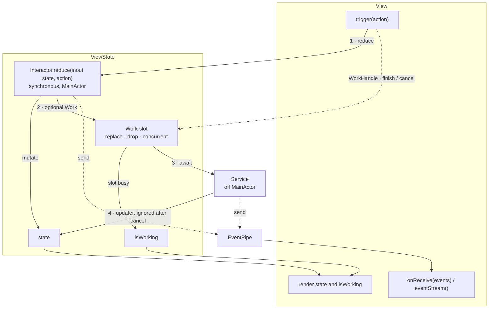

# View · ViewState · Interactor (VVSI)

VVSI is a thin unidirectional layer for SwiftUI: something between [TCA](https://github.com/pointfreeco/swift-composable-architecture) and free-form MVVM, without TCA ceremony.

**View** renders state and sends actions. **ViewState** owns state. **Interactor** reduces synchronous actions immediately and returns optional async **Work**. One-shot UI (alerts, toasts) uses **events**, not state flags.

Latest published version: **0.2.0-alpha.1**. This checkout contains **unreleased** lifecycle and API fixes; the examples below target this checkout. See [Migration](#migration-from-020-alpha1) and [Changelog](CHANGELOG.md).

## Architecture



Synchronous actions complete before `trigger` returns and allocate no task. Returned `Work` runs as a tracked unstructured task and replaces the previous one, so there is no name to mistype. A returned `WorkHandle` can be awaited or cancelled. `viewState.cancel()` invalidates all in-flight work; releasing the ViewState also requests cancellation.

## Why VVSI

- Clear split: UI / state / side effects
- Zero-task fast path for synchronous actions
- Predictable async updates via `updater`
- Easy to unit-test Interactor + ViewState
- Async `Work` with policies and cooperative cancellation
- Loading indicator owned by the runtime (`isWorking`), not a hand-maintained flag
- Native SwiftUI: `@Observable` on iOS 17+, `ObservableObject` for older targets

### Compared with MVVM

VVSI keeps the low ceremony and native SwiftUI integration of a small ViewModel, but makes the feature contract explicit:

- user intent is represented by typed actions instead of arbitrary ViewModel methods;
- synchronous state transitions happen in one `reduce` entry point;
- async work has shared cancellation and concurrency policies;
- one-shot events do not need to be stored as resettable state flags;
- Interactor and ViewState can be tested without rendering a View.

The trade-off is additional structure. A simple screen with a few independent properties may be clearer as plain MVVM.

### Compared with TCA

VVSI adopts unidirectional actions and reducer-like state changes, but intentionally omits most framework machinery:

- no external dependencies beyond Apple frameworks;
- no Store scoping, dependency system, navigation model, macros, or exhaustive TestStore;
- synchronous actions do not allocate a task;
- async `Work` updates state directly through a MainActor-isolated updater;
- the API is small enough to understand from the core source files.

This makes VVSI easier to introduce feature by feature, but less strict than TCA. In TCA, async work normally sends another action through the reducer; in VVSI, `Work` may update state directly. TCA is a better fit when exhaustive state-transition testing, deep composition, and standardized dependency management are more important than a minimal API.

### When VVSI fits

Choose VVSI when plain MVVM has become difficult to keep consistent, but adopting a full application architecture would be disproportionate. It is aimed at small and medium SwiftUI features that need predictable state, testable async work, and cancellation without a large framework surface.

VVSI is not intended to replace TCA for every application. Large state trees, complex navigation, cross-feature composition, and organization-wide architecture enforcement are currently outside its scope.

## Installation

### Swift Package Manager

For the latest published prerelease:

```swift
dependencies: [
    .package(url: "https://github.com/hudishkin/vvsi.git", exact: "0.2.0-alpha.1")
]
```

To use the unreleased API shown below, add this checkout as a local package:

```swift
dependencies: [.package(path: "../vvsi")]
```

The library supports Swift 5.9+, iOS 13+, macOS 10.15+, and tvOS 13+. The SwiftUI examples use iOS/tvOS 16+ and macOS 13+ APIs. Running the test suite requires a Swift 6+ toolchain and macOS 13+; Observation tests additionally require macOS 14+.

### Cursor Skill

```bash
mkdir -p skills
cp -R path/to/vvsi/skills/vvsi skills/vvsi
```

See [`skills/vvsi`](skills/vvsi).

## How to use

### 1. State, actions, events

```swift
import Foundation
import VVSI

extension ListView {

    struct VState: StateProtocol {
        struct Item: Identifiable, Sendable {
            let id = UUID()
            let title: String
        }

        var items: [Item] = []
    }

    enum VAction: ActionProtocol {
        case add
        case remove
        case load
    }

    enum VEvent: EventProtocol {
        case error(String)
    }
}
```

### 2. Interactor

```swift
import VVSI

extension ListView {

    final class Interactor: ViewStateInteractorProtocol, InitialStateProtocol {

        typealias S = VState
        typealias A = VAction
        typealias N = VEvent

        let events = EventPipe<N>()
        let initialState = VState(items: [.init(title: "initial item")])

        @MainActor
        func reduce(_ state: inout S, _ action: A) -> Work<S>? {
            switch action {
            case .add:
                guard state.items.count < 5 else {
                    events.send(.error("Max items count is 5"))
                    return nil
                }
                state.items.append(.init(title: "New item"))
                return nil

            case .remove:
                if !state.items.isEmpty {
                    state.items.removeLast()
                }
                return nil

            case .load:
                return Work { [events] _, updater in
                    do {
                        try await Task.sleep(for: .milliseconds(100))
                        let items = [VState.Item(title: "Loaded")]
                        try Task.checkCancellation()
                        await updater { $0.items = items }
                    } catch {
                        guard !Task.isCancelled else { return }
                        events.send(.error(error.localizedDescription))
                    }
                }
            }
        }
    }
}
```

### 3. View

```swift
import SwiftUI
import VVSI

@MainActor
struct ListView: View {

    enum AlertType: Identifiable {
        var id: String { "\(self)" }
        case error(String)
    }

    @StateObject
    private var viewState = ViewState(Interactor())

    @State
    private var alertType: AlertType?

    var body: some View {
        VStack {
            if viewState.isWorking { ProgressView() }
            ForEach(viewState.state.items) { item in
                Text(item.title)
            }
            Button("Add") { viewState.trigger(.add) }
            Button("Remove") { viewState.trigger(.remove) }
        }
        .alert(item: $alertType) { item in
            switch item {
            case .error(let message):
                Alert(
                    title: Text("Error"),
                    message: Text(message),
                    dismissButton: .default(Text("Ok"))
                )
            }
        }
        .onReceive(viewState.events) { event in
            switch event {
            case .error(let message):
                alertType = .error(message)
            }
        }
        .task {
            await viewState.trigger(.load)?.finish()
        }
    }
}
```

`isWorking` is owned by the runtime. It turns on in `trigger`, stays on while one `Work` replaces another, and turns off when the slot's work completes or is cancelled — including by `.task` when the view goes away. A cancelled operation that ignores cancellation no longer counts. `Work(.concurrent)` does not affect it. Do not mirror it with an `isLoading` field in `VState`.

On iOS 17+ / macOS 14+, use `ObservableViewState` with `@State` instead of `ViewState` with `@StateObject`; everything else is identical:

```swift
@State
private var viewState = ObservableViewState(Interactor())
```

`@State` evaluates that initializer every time the parent rebuilds the view and keeps only the first instance. Keep `Interactor.init` cheap: store dependencies there, start requests from `.task`.

Inject a fake Interactor in previews/tests: `ViewState(.init(...), FakeInteractor())`.

For async event consumption, request a stream when the consumer starts:

```swift
for await event in viewState.eventStream() {
    // Handle event.
}
```

Each call creates an independent subscription. The default buffer keeps only the newest pending event; pass a different `AsyncStream.Continuation.BufferingPolicy` when needed.

## Testing

Drive `trigger` and assert on `state` / `events`. Await `handle.finish()` for completed operations; use controlled async dependencies to test cancellation and replacement without sleeps. See [state/event tests](Tests/VVSITests/VVSITests.swift) and [shared work-lifetime tests](Tests/VVSITests/WorkLifetimeTests.swift).

```bash
swift test
```

## Work lifetime and cancellation

`trigger` always performs the synchronous reduction first. It returns `nil` for a synchronous action, or a `WorkHandle` for returned work. You can ignore the handle. A plain `Work` takes the screen's single slot and cancels whatever was there. `Work(.dropWhileRunning)` uses that same slot but resolves to `.dropped` when it is busy; the synchronous reduction still runs. Keep duplicate-sensitive mutations out of that reduction, or guard them explicitly in the Interactor. `Work(.concurrent)` stays outside the slot.

```swift
.refreshable {
    await viewState.trigger(.load)?.finish()
}
```

`finish()` returns `.completed` when the operation returns, `.cancelled` when cancelled, or `.dropped` when rejected. Completion does not imply application-level success: handle domain errors in the Interactor. Cancellation of a task awaiting `finish()` cancels that work, so the same pattern integrates with SwiftUI `.task`. Multiple waiters share one work lifetime; cancelling any waiter cancels that work for all of them. Do not share one handle across independent tasks.

Cancellation invalidates the work's updater immediately and requests cooperative task cancellation. Waiting handles resolve promptly even when an operation ignores cancellation; they do not wait for that operation to physically exit. Updates from escaped callbacks or other tasks are also rejected after cancellation or completion. External I/O and arbitrary events still require cancellation-aware code.

`ViewState` owns its work. When it is released, pending work is cancelled without retaining the container. An escaped `CurrentState` reader returns the last committed state after the owner disappears. Avoid capturing a ViewState strongly inside your own work or dependencies.

Cancellation does not run a reducer. `.task { await trigger(...)?.finish() }` cancels that Work when the view goes away, and `isWorking` turns off. Call `viewState.cancel()` only when the ViewState itself survives disappear (tabs, shared owner). That invalidates all work and then calls `Interactor.didCancel`, which is a no-op unless you implement it. Use it only for state other than the loading indicator, for example a half-filled draft that a full cancel must discard. `handle.cancel()`, a replaced `Work`, and `finish()` do not call `didCancel`.

To stop one parallel operation without stopping the others, keep the handle `trigger` returned and call `handle.cancel()`. That is the only selective cancellation: there is no key that a second call site can misspell.

Events sent directly through `EventPipe` are independent of Work lifetimes. `viewState.events` hops to the next `DispatchQueue.main` turn, so the View may already see the new state before the event. `eventStream()` delivers synchronously with `send`. A queued event is not retracted by cancelling work. Check cancellation before sending async events. The default `eventStream` buffer deliberately coalesces bursts to the newest pending event; use another buffering policy when every event matters.

## Migration from 0.2.0-alpha.1

- `ViewState`, `ObservableViewState`, and `ViewStateProtocol` are now `@MainActor`. Create and read them on the main actor; annotate feature Views and relevant tests with `@MainActor` when needed.
- `trigger` returns `WorkHandle?`. Existing calls that ignore its result continue to work. Custom `ViewStateProtocol` conformers must update the signature.
- `Work { }` replaces the previous work. `WorkKey`, string keys, and `cancel(key:)` are gone. `.dropWhileRunning` and `.concurrent` take no identifier. The default is replacement, not concurrent execution.
- Replace `isLoading` in `VState` with `viewState.isWorking`. Do not add a dummy `.stop` action or write leftover flags from the View. Call `viewState.cancel()` only when ViewState outlives the screen. Custom `ViewStateProtocol` conformers must provide `isWorking`.
- Updaters expire when their originating work ends. For callback APIs, keep the operation alive until the callback completes instead of returning immediately after registration.
- Replace completion callbacks in actions with `await viewState.trigger(action)?.finish()`.
- `CurrentState` remains nonoptional; after owner release it returns the last committed snapshot.
- The public `events` publisher is immutable. Classic `state` / `$state` observation is unchanged. `ObservableViewState` is no longer experimental.

## Migration 0.0.x → 0.2.0

| Was | Now |
|---|---|
| `NotificationProtocol` / `VNotification` | `EventProtocol` / `VEvent` |
| `notifications` / `PassthroughSubject` | `events` / `EventPipe` (+ `eventStream()`) |
| `await state()` / `S?` | direct `inout state` in `reduce`; `await state()` → `S` inside `Work` |
| `await updater { }` | direct mutation in `reduce`; `await updater { }` inside `Work` |
| sync `execute` + manual `Task` | sync `reduce` returning optional `Work` |
| — | one slot: `Work { }`, `.dropWhileRunning`, `.concurrent` |
| — | `cancel()` invalidates all in-flight work and requests cancellation |

Long-running `Work` must cooperate with cancellation (`Task.checkCancellation()`, `try await Task.sleep`). Call `cancel()` from the View lifecycle when work should not outlive the screen.

`reduce` is isolated to `MainActor`; `Work` is not. Networking and CPU-heavy processing therefore run away from the UI executor, while `state()` and `updater` safely hop to `MainActor`. A plain `Work` replaces the previous request. Use `.dropWhileRunning` to ignore a duplicate, and `.concurrent` only when an operation must keep running beside that slot.

Keep feature state focused. Split large screens into smaller View/ViewState pairs, and keep high-frequency intermediate values such as drag or slider position in local `@State` until they need to become feature actions.

## Choosing an adapter

[`ObservableViewState`](Source/VVSI/ObservableViewState.swift) uses the Observation framework (`@Observable`) and is the recommended adapter on iOS 17+ / macOS 14+ / tvOS 17+. `ViewState` uses `ObservableObject` for older deployment targets. Both run the same work runtime and pass the same lifetime tests. State is one value in both: changing any field updates every view that reads `state`. Split large screens into focused ViewStates rather than relying on field-level observation.

## Core concepts

- **StateProtocol** — feature state (`Sendable`)
- **ActionProtocol** — intents from the View
- **EventProtocol** — `Sendable` one-shot signals from Interactor to View
- **EventPipe** — `send` + Combine publisher + `AsyncStream`
- **Work** — optional asynchronous continuation of a synchronous reduction
- **WorkPolicy** — replace the current work, drop a duplicate, or run beside the slot
- **WorkHandle** / **WorkOutcome** — awaitable work lifetime and cancellation
- **`isWorking`** — runtime-owned loading indicator for the slot
- **`didCancel`** — optional Interactor hook after `viewState.cancel()`; default is a no-op
- **ViewStateInteractorProtocol** — synchronous `reduce(&state, action) -> Work?`
- **InitialStateProtocol** — Interactor provides `initialState`

## Example app

List + Remote + Observable list: [`VVSIExample`](VVSIExample). The Xcode example targets iOS 18.2+ and its tests use injected requests without network access.

## License

MIT. See [LICENSE](LICENSE).

## Contributing

Issues and PRs are welcome.
